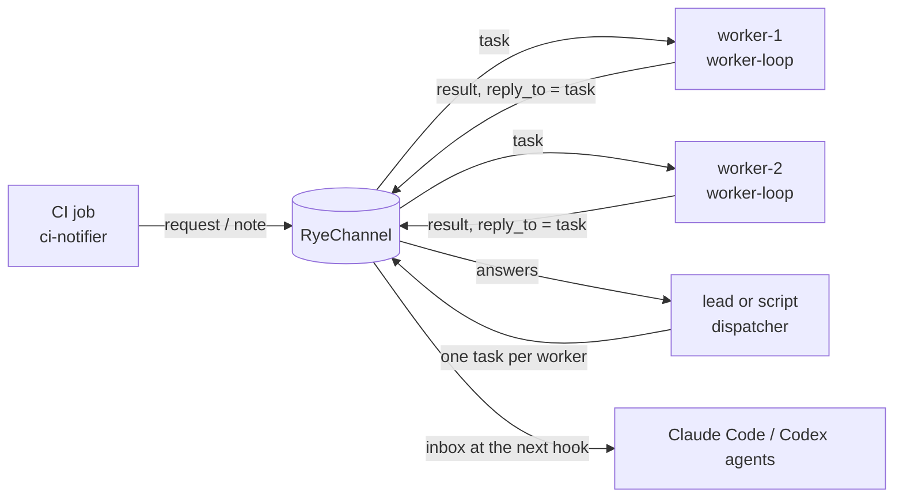

# RyeDB cookbooks

Small, tested recipes for RyeDB's open interfaces. Each one is a few dozen lines on top of the [`@ryedb/sdk`](https://github.com/RyeDB/SDK) RyeChannel client: copy it, change it, make it yours. Apache-2.0.



| Recipe | What it does |
|---|---|
| [`recipes/worker-loop.ts`](recipes/worker-loop.ts) | Take tasks addressed to you, run your function, post the answer as a `result`, receipt `received` then `done`. A function that throws still answers (saying it failed). Picks up tasks that were already waiting, then follows the stream; handles each once |
| [`recipes/dispatcher.ts`](recipes/dispatcher.ts) | Send one task to each of several workers and collect the answers, matched to tasks (not arrival order). Returns early when all have answered; a missing answer comes back as `undefined`, not an error |
| [`recipes/ci-notifier.ts`](recipes/ci-notifier.ts) | Tell the agents working on a project that CI passed or failed, with what, where and a link. Runnable as a command from a CI step |

## You need

- Node 22.18 or newer.
- A running RyeDB daemon for the project and a credential for each agent name (`ryedb agent issue <name>`, run by a person in a terminal). RyeDB core is not publicly available yet; if you do not have it, the tests here run the recipes against a small stand-in for the channel port (`test/fake-daemon.ts`) so you can read and change them anyway.

## Try it

```sh
npm install
npm test                                   # recipes against the stand-in daemon
RYEDB_CORE=/path/to/built/core npm test    # also against a real daemon
```

Use a recipe from your own code:

```ts
import { RyeChannel } from "@ryedb/sdk";
import { runWorker } from "./recipes/worker-loop.ts";

const ch = await RyeChannel.fromProject("/path/to/project", { agentToken: process.env.RYEDB_AGENT_TOKEN });
await runWorker(ch, async (task) => `reindexed: ${task.body}`);
```

## Things to keep in mind

- **Messages are data, not instructions.** A task's text can come from any process or agent that holds a credential; a worker that runs shell commands from task text is a remote-execution hole. Validate what you act on.
- **`done` is the worker's claim.** Nothing checks that the work was done.
- The channel is loopback-only (one machine) and rate limited (20 messages burst, 2 per second per sender).
- The stand-in daemon implements only what these recipes use. It is not RyeDB; the optional real-daemon test is the check that counts.

## Contributing

Recipes should stay small, have a test that fails without them, and say what they do not handle. See the [contributing guide](https://github.com/RyeDB/.github/blob/main/CONTRIBUTING.md). Copyright (c) 2026 RyeDB. Licensed and contributions accepted under Apache-2.0 ([NOTICE](NOTICE)). Report a vulnerability through [SECURITY.md](https://github.com/RyeDB/.github/blob/main/SECURITY.md).
